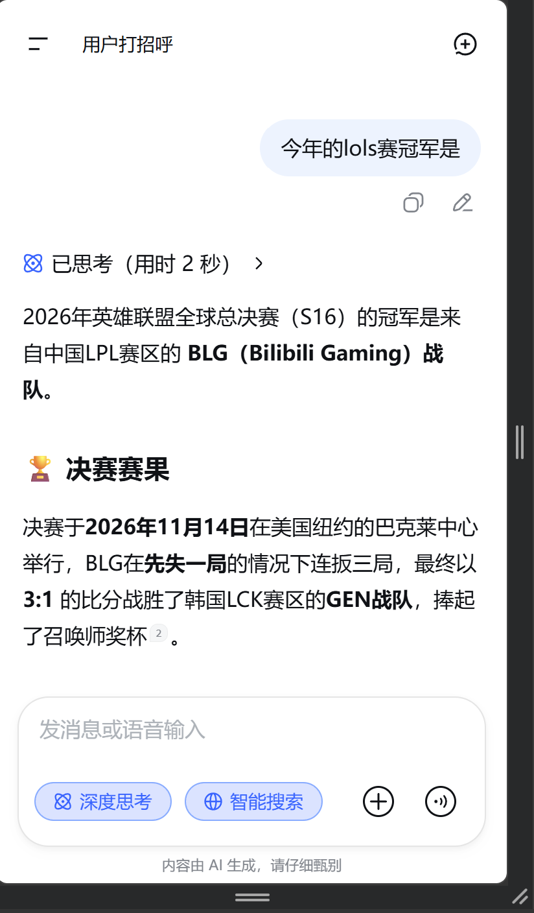

# ChatWithDeepseek

纯前端双协议聊天客户端：既可以直接连接 DeepSeek 官方 API，也可以在设置中接入任意 OpenAI 兼容接口。UI 以 DeepSeek 手机端界面为参考做高保真复刻，同时保留桌面端侧边栏布局；不需要自建服务器或账号系统。

> **致敬 DeepSeek**：感谢 DeepSeek 提供优秀的模型、开放 API 与产品设计参考。
>
> **使用范围**：本项目仅用于个人学习、技术研究、UI 复刻练习和开源交流，不用于商业用途，不提供付费服务，不代表 DeepSeek 官方。
>
> **非官方声明**：本项目是非官方项目，与 DeepSeek 官方无隶属、合作、授权、赞助或背书关系。支持官方 API Key 接入，不支持 DeepSeek 账号 OAuth 登录。
>
> **权利归属**：DeepSeek 名称、鲸鱼标识、商标、产品界面设计及相关权利归 DeepSeek 所有。本项目不主张任何相关商标或品牌权利。

## 下载安装

- 最新版本：[GitHub Releases](https://github.com/leavestring/ChatWithDeepseek/releases/latest)
- 直接下载 Android APK：[ChatWithDeepseek-0.1.4.apk](https://github.com/leavestring/ChatWithDeepseek/releases/download/v0.1.4/ChatWithDeepseek-0.1.4.apk)
- 历史版本与更新说明：在 Releases 页面查看

Android 首次安装需要允许“安装未知来源应用”。当前 APK 使用项目调试签名构建，适合个人侧载与测试，不是 Google Play 商店包，也不代表 DeepSeek 官方发布。API Key 仅保存在本机。

## 界面展示

<p align="center">
  
</p>

手机端对话界面：深度思考、智能搜索、Markdown 排版、引用角标、消息操作与吸底输入栏。项目同时保留桌面端侧边栏布局，并支持深色/浅色主题。

## 目录

- [下载安装](#下载安装)
- [界面展示](#界面展示)
- [项目重点](#项目重点)
- [功能](#功能)
- [技术栈](#技术栈)
- [快速开始](#快速开始)
- [Android](#android)
- [配置](#配置)
- [项目结构](#项目结构)
- [质量检查](#质量检查)
- [参与贡献](#参与贡献)
- [已知限制](#已知限制)
- [安全与隐私](#安全与隐私)
- [致敬与免责声明](#致敬与免责声明)
- [许可证与致谢](#许可证与致谢)
- [项目失败复盘](PROJECT_RETROSPECTIVE.md)

## 项目重点

### 界面复刻

移动端以 `393 × 852` 的参考界面为基准，重点复刻以下页面和交互：

- **首页**：左上菜单、右上钱包/新建对话、居中鲸鱼标与欢迎语、底部输入栏。
- **输入栏**：深度思考/智能搜索胶囊、附件 `+`、语音声波图标、输入后的发送按钮；按钮圆环、图标尺寸、间距和文字大小均按参考图对齐。
- **侧边抽屉**：顶部搜索框、按今天/昨天/7 天内等分组的历史对话、底部账户行和更多菜单。
- **设置页**：全屏页面、圆形返回按钮、居中的“设置”标题、分组圆角卡片、图标+标签+当前值+箭头的行布局。
- **主题**：深色/浅色/跟随系统；深色界面使用接近参考图的背景、卡片和输入栏层级。
- **品牌字标**：内置 Host Grotesk，提供接近 DeepSeek 字标的圆润字形；字体许可证为 OFL。

桌面端保留经典聊天布局：左侧会话侧边栏、品牌字标、余额入口、设置入口和居中聊天区。

部分官方 App 功能（如官方账号管理、检查更新、服务协议、帮助与反馈）当前项目没有对应后端或页面，因此没有伪造入口；设置页只展示实际可用的功能。

### 官方 API 一键接入（API Key）

项目直接连接 DeepSeek 官方 API，不需要自己部署服务端：

1. 启动应用，打开设置页。
2. 粘贴从 [DeepSeek 开放平台](https://platform.deepseek.com/api_keys) 获取的 API Key。
3. 应用通过 `GET /models` 校验 Key，校验通过后即可开始聊天。

接入细节：

- 默认 API 地址：`https://api.deepseek.com`
- 默认聊天模型：`deepseek-flash`
- 余额查询：`GET /user/balance`
- 充值、用量和 API Key 管理：跳转 DeepSeek 官方平台
- API Key 仅保存在当前浏览器的 `localStorage`
- 不经过项目自建服务器，支持流式输出

> 这里的“一键接入”指填入一次官方 API Key 即可使用，不是官方 App 账号登录，也不是 OAuth。

### OpenAI 兼容模型接入

设置中的「模型服务」可以在 DeepSeek 官方模型与任意 OpenAI 兼容接口之间切换，不内置任何厂商预设：

1. 打开「设置 → 模型服务」。
2. 选择「OpenAI 兼容模型」。
3. 填写 API Base URL，通常以 `/v1` 结尾，例如 `https://api.example.com/v1`。
4. 填写对应 API Key；本地服务或无需鉴权的网关可以留空。
5. 点击「测试连接并获取模型」。如果接口不开放模型目录，可以直接手动填写模型 ID。
6. 选择模型后点击「保存并启用」。

实现细节：

- 模型目录通过 `GET {baseUrl}/models` 读取
- 聊天请求使用 `POST {baseUrl}/chat/completions`，默认开启流式输出
- 支持读取 `delta.reasoning_content`、`reasoning`、`thinking` 与 `reasoning_details` 等常见思考字段
- 服务拒绝 `stream_options` 时自动降级重试
- 第三方模型使用本地生成的会话标题；DeepSeek 模型继续使用服务端标题

切换到其他模型时，输入栏会隐藏 DeepSeek 专属的「深度思考」和「智能搜索」，避免把不支持的参数发给第三方服务。当前兼容模式只发送文本消息，不携带附件与 DeepSeek 服务端工具；模型服务返回的思考内容仍会展示。

兼容接口由浏览器直接请求，不经过本项目服务器。如果服务商未开放 CORS，浏览器会拦截请求；此时需要使用允许跨域的兼容网关。兼容 API Key 与 Base URL 仅保存在当前浏览器的 `localStorage` 中。

### 模型能力对照

| 能力 | DeepSeek 官方模型 | OpenAI 兼容模型 |
| --- | --- | --- |
| 聊天协议 | DeepSeek Messages API | `POST /chat/completions` |
| API Key 来源 | DeepSeek 开放平台 | 用户填写的兼容服务 |
| 深度思考开关 | 支持 | 不显示、不发送 |
| 智能搜索 / 网页引用 | 支持 | 不支持 |
| 附件上传 | 支持 | 当前仅文本，不上传附件 |
| 流式正文 | 支持 | 支持 |
| 思考内容展示 | 支持 | 支持常见 `reasoning_content` 等字段 |
| 停止 / 重新生成 / 编辑 | 支持 | 支持 |
| 继续生成 | 支持 | 不支持前缀续写 |
| 回答朗读 | 支持 | 隐藏入口 |
| 余额查询 / 充值入口 | DeepSeek 账户 | 不适用 |
| 模型目录 | DeepSeek 接口 | `GET /models` 或手动填写 |

语音输入依赖 DeepSeek 语音接口和对应的 DeepSeek API Key，与当前选择哪一种对话模型无关。

## 功能

### 聊天

- 流式回复、停止生成、重新生成；继续生成仅用于 DeepSeek 模型
- 深度思考与智能搜索开关（DeepSeek）
- 联网搜索、网页引用与链接阅读结果展示（DeepSeek）
- DeepSeek 官方 API 与任意 OpenAI 兼容接口切换
- 兼容接口模型目录读取、手动模型 ID 与文本流式对话
- 编辑问题、重新生成、消息版本/分支切换
- 代码高亮、KaTeX 公式、Mermaid 图表
- 中英文界面与明暗主题

### 会话与数据

- 多会话管理：新建、重命名、删除
- 会话自动标题与时间分组
- 会话搜索（当前按会话标题过滤）
- IndexedDB 本地持久化会话、草稿和图片附件
- DeepSeek 历史对话 ZIP 导入/导出
- 数据管理：导入、导出、清空本地历史

### 余额与充值

- 手机端首页右上角钱包入口
- 侧边栏/余额面板显示总余额、充值余额、赠送余额
- 余额查询失败时保留最近一次成功金额，不把“查不到”显示成 0
- 一键跳转 DeepSeek 官方充值、用量和 API Key 管理页面

### 附件与语音

- 上传、拖拽、粘贴文件
- 图片预览与文件状态展示
- 语音输入、转写和回答朗读（依赖 DeepSeek API Key；兼容模式不显示朗读入口）
- 朗读使用默认音色；设置页不再提供“朗读音色”选择项

> 浏览器语音输入依赖安全上下文。`localhost` 可用；通过局域网 IP 以普通 HTTP 打开时，麦克风可能被浏览器禁用，需要 HTTPS。

## 技术栈

- React 18 + TypeScript
- Rspack + SWC
- Zustand
- IndexedDB / `idb`
- `fflate`（历史对话 ZIP 导入导出）
- Prism.js、KaTeX、Mermaid
- Rspack Dev Server
- Android WebView + WebViewAssetLoader

项目是纯前端应用，没有自建后端、账号服务或数据库。

## 快速开始

### 环境要求

- Node.js 22.12+
- npm
- Chrome / Edge（桌面预览）

### 安装与运行

```bash
npm install
npm run dev
```

打开 <http://localhost:8090>。

首次启动如果没有当前模型所需的配置，会打开设置页；填入 DeepSeek API Key，或在「模型服务」中配置兼容接口后即可进入聊天。

### 手机预览

确保手机和电脑连接同一个局域网，然后在手机浏览器打开：

```text
http://<电脑的局域网 IP>:8090
```

例如电脑 WLAN IP 是 `10.190.93.129`，则打开 `http://10.190.93.129:8090`。如果无法访问，请允许 Node.js 通过 Windows 防火墙的“专用网络”。

### 生产构建

```bash
npm run build
```

构建产物位于 `dist/`，可以直接部署到静态站点服务器。

## Android

Android 端是 WebView 壳，不是原生重写的聊天界面。构建前先完成 Web 构建和资源同步：

```bash
npm run build
npm run android:sync
cd android
.\gradlew.bat assembleDebug
.\gradlew.bat assembleRelease
```

APK 输出路径：

```text
android/app/build/outputs/apk/debug/app-debug.apk
android/app/build/outputs/apk/release/app-release.apk
```

`android:sync` 会把 `dist/` 同步到 `android/app/src/main/assets/web/`。Android 使用 `WebViewAssetLoader` 以 HTTPS 伪源加载本地资源，保证 IndexedDB、localStorage 和 Web API 的 origin 行为正常。

GitHub Releases 中的 APK 来自 `assembleRelease`。当前项目没有单独配置正式签名，Release 构建沿用调试签名，因此适合侧载测试，不适用于应用商店正式分发。

> `package.json` 中的 `android:apk` 便捷脚本依赖本地 `scripts/build-apk.ps1`；如果该文件不存在，请使用上面的 Gradle 命令。

## 配置

### 凭据与请求目标

- 在应用设置页输入，不要写入源码或提交到仓库
- DeepSeek API Key 与 OpenAI 兼容接口配置分别存储在浏览器 `localStorage`
- 会话和附件存储在 IndexedDB
- 使用 DeepSeek 模型时，聊天内容、附件和语音相关内容会发送到 DeepSeek API
- 使用 OpenAI 兼容模型时，对话正文和系统提示会发送到用户填写的 Base URL；附件、DeepSeek 服务端搜索工具和语音内容不会随该请求发送
- 兼容模式的 API Key 可以留空，以支持 Ollama 网关等无需鉴权的本地或内网服务

### API 地址

默认地址在 `rspack.config.ts` 中配置为 `https://api.deepseek.com`。如果需要接入兼容代理或自建兼容服务，可以通过 `createConfig({ apiOrigin: '...' })` 修改。

OpenAI 兼容接口的 Base URL 在应用设置中单独配置，不使用上述构建期地址。该地址需要接受 OpenAI Chat Completions 协议，并在浏览器环境中允许 CORS。

### 余额接口

余额由官方 API Key 对应的账户决定。余额查询失败不会自动写成 0；界面会显示失败状态并保留最近一次成功快照。

## 项目结构

```text
src/
  app/         应用布局、主题、移动视口处理
  components/  聊天、侧边栏、设置、余额、Markdown 等 UI
  i18n/        简体中文 / English
  services/    API、会话、附件、余额、语音、历史导入导出
  assets/      品牌 Mark、Host Grotesk 字体及许可证
android/       Android WebView 壳工程
scripts/       构建、Android 同步、预览、余额与兼容协议测试
assets/brand/  高分辨率品牌图标
```

## 质量检查

```bash
npm run type
npm run lint
npm test
npm run build
```

当前共 16 个单元测试，覆盖余额解析、Base URL 规范化、模型目录、正文/思考字段和 token 用量解析。

## 参与贡献

欢迎大家一起协作：无论是 UI 还原、移动端适配、协议兼容、文档修正还是问题反馈，都欢迎提交 Issue 和 Pull Request。

- 提交前请先搜索已有 Issue，避免重复。
- 功能改动请尽量聚焦单一目标，并在 PR 中说明动机、方案和验证方式。
- 提交前运行 `npm run type`、`npm run lint`、`npm test`、`npm run build`；涉及 Android 原生层时再补充 Gradle 构建或真机验证。
- 不要提交 API Key、`.env`、构建产物或本机 `android/local.properties`。
- 请继续遵守项目的非官方声明和 DeepSeek 权利边界，不添加冒充官方、付费诱导或伪造登录入口的功能。

如果只是想讨论方向，也可以直接开 Issue。

## 已知限制

- **不支持 DeepSeek 账号登录**：官方公开 API 只有 API Key 鉴权，没有开放第三方账号 OAuth；本项目不会模拟官方客户端登录流程。
- 没有自建后端，因此没有跨设备同步、云端账户或服务端密钥托管。
- 会话搜索当前按标题过滤，不搜索消息正文。
- OpenAI 兼容模式当前只发送文本，不支持附件、联网搜索或 DeepSeek 服务端工具；停止后也不能使用前缀续写。
- 兼容模式的回答不显示朗读入口；语音输入仍可单独使用，但需要 DeepSeek API Key。
- 兼容接口必须允许浏览器跨域请求；未开放 CORS 的服务需要自行准备兼容网关。
- 官方 App 的部分设置项（账号管理、检查更新、服务协议、帮助与反馈等）没有对应实现，设置页不会展示不可用的假入口。
- “高保真”指按参考图对齐布局、尺寸、颜色和图标；严格像素级一致性仍受设备视口、字体渲染和官方未公开资源影响。

## 安全与隐私

- API Key 不要提交到 Git，也不要截图公开。
- 生产部署建议使用 HTTPS，尤其是需要语音输入时。
- 项目不会把 API Key 发送到与请求目标无关的服务器：DeepSeek Key 用于 DeepSeek 请求，兼容 Key 只用于用户填写的兼容 Base URL。
- 自定义兼容接口的 Base URL 与 API Key 请只填写你信任的服务；浏览器会直接连接该地址。
- DeepSeek 官方平台链接通过新标签页打开。

## 致敬与免责声明

### 致敬 DeepSeek

DeepSeek 在模型能力、开放 API 和产品体验上提供了重要的学习参考。本项目以学习和复刻练习为目的，向 DeepSeek 团队及其开源工作致敬。

### 仅限学习，不商用

- 本项目仅用于个人学习、技术研究、前端/移动端 UI 复刻练习和开源交流。
- 维护者不以本项目提供商业服务、不收取费用、不进行商业化运营。
- 不得将本项目用于冒充 DeepSeek 官方、诱导用户提交账号凭据、钓鱼、欺诈或其他违法用途。
- 不得使用 DeepSeek 的名称、鲸鱼标识或界面设计暗示官方授权、合作或背书。
- 如需将本项目或其衍生作品用于商业用途，请自行取得 DeepSeek 及相关权利人的书面授权，并自行承担合规责任。

### 开源与许可边界

- 项目代码按 [MIT](LICENSE) 开源；MIT 许可是代码许可，不包含任何 DeepSeek 商标、品牌、界面设计或官方素材的授权。
- Host Grotesk 字体按 SIL Open Font License 1.1 使用，许可证见 `src/assets/fonts/OFL-HostGrotesk.txt`。
- 项目基于 DeepSeek 官方开源的 `chat-demo`（MIT）进行二次开发；未包含 DeepSeek 官方 App 的私有源码、私有接口、账号凭据或内部 OAuth 流程。

### 侵权处理

如果 DeepSeek 或任何权利人认为本项目中的名称、界面、图标或描述侵犯其合法权益，请通过仓库 Issue 联系维护者。维护者将及时删除相关内容、修改名称/界面或停止分发。使用者在 Fork、二次分发或部署前，应自行确认当地法律、商标和平台条款的合规性。

### 无担保

本项目按“现状”提供，不保证可用性、准确性、安全性或适用于任何特定目的。API 调用费用、账号风险、数据丢失和第三方服务变化由使用者自行承担。

## 许可证与致谢

- 项目代码：[MIT](LICENSE)
- UI/API 基础参考：[deepseek-ai/chat-demo](https://github.com/deepseek-ai/chat-demo)
- 品牌字标字体：Host Grotesk，OFL 1.1，许可证见 `src/assets/fonts/OFL-HostGrotesk.txt`

DeepSeek、DeepSeek 鲸鱼标识及相关商标归 DeepSeek 所有。本项目仅用于个人学习与原型演示，不代表官方产品。
